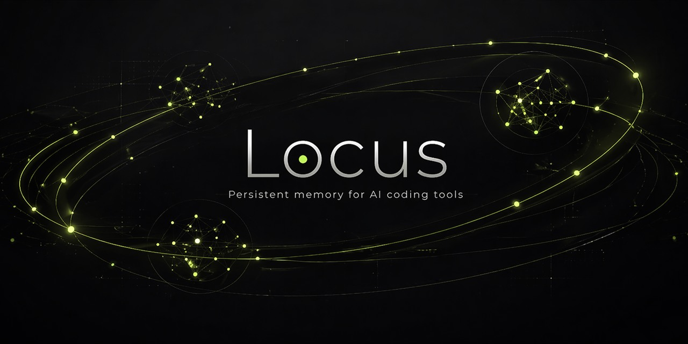

# Locus

> Локальная постоянная память для AI coding tools. Работает через MCP. Основной фокус сейчас — Codex CLI.



[English](../README.md) · [Русский](README.ru.md) · [简体中文](README.zh-CN.md)

## Что это

AI-агент начинает новую сессию почти с нуля: не помнит решения, ошибки, стиль пользователя и то, что делали вчера. Locus добавляет локальную память, которую агент может искать через MCP.

Locus хранит:

- карту проекта: файлы, exports, imports
- важные решения: архитектура, ограничения, предпочтения
- историю Codex-сессий: ошибки, следующие шаги, отвергнутые варианты
- диагностику: что импортировано, что сохранено, какой режим capture включён

Данные остаются локально. По умолчанию Locus не требует облака, аккаунта, внешней базы, embeddings-провайдера или LLM-вызова для записи памяти.

## Установка для Codex

```bash
npx -y locus-memory@latest install codex --yes
```

Перезапустите Codex и проверьте:

```bash
npx -y locus-memory@latest doctor codex
```

Удалить MCP-настройку, но оставить локальные данные памяти:

```bash
npx -y locus-memory@latest uninstall codex --yes
```

Команда установки добавляет MCP-сервер Locus, устанавливает Codex skill, включает практичный `redacted` режим и закрепляет runtime-команду на установленную версию пакета.

> **Статус релиза `v4.0.0`:** версия `v4.0.0` опубликована в [GitHub Releases](https://github.com/Magnifico4625/locus/releases/tag/v4.0.0) с прикреплённым архивом `locus-memory-4.0.0.tgz`; публикация `locus-memory@4.0.0` в npm ожидает ручного `npm publish`, поэтому до обновления npm используйте `.tgz` из GitHub Release или локальную сборку (`npm run build`).

### Zero-call десктопные плагины (Codex, Antigravity, DeepSeek Harness)

Для автоматической инъекции контекста на старте/ходе и фонового захвата памяти без ручных вызовов MCP:

```bash
# Codex CLI / Desktop: zero-call хуки и локальный runtime в ~/.locus/bin/
npx -y locus-memory@latest install codex --with-hooks --yes

# Antigravity Desktop: нативный плагин (~/.gemini/config/plugins/locus-memory/)
npx -y locus-memory@latest install antigravity --yes
npx -y locus-memory@latest doctor antigravity
npx -y locus-memory@latest uninstall antigravity --yes

# DeepSeek Harness Desktop (dsh): in-process Cordis-плагин locus-memory-dsh
npx -y locus-memory@latest install dsh --yes
npx -y locus-memory@latest doctor dsh
npx -y locus-memory@latest uninstall dsh --yes
```

- **Strict Workspace Gate:** хуки игнорируют домашнюю/системные/temp-папки и каталоги без маркера проекта (для opt-in достаточно пустого `.locus.json` или настройки `~/.locus/config.json`).
- **Дневник памяти по датам:** автоматически поддерживаются `daily_summaries` в SQLite и Markdown-файлы `journal/YYYY-MM-DD.md` + `journal/INDEX.md`, а `memory_compact` сжимает старые сырые `tool_use` с `PRAGMA wal_checkpoint(TRUNCATE)`.
- Дорожная карта десктопных плагинов: [roadmap/v4-multi-platform-plugins.md](roadmap/v4-multi-platform-plugins.md).

## Что нового в v4.0

**Мультиплатформенные zero-call плагины (`v4.0.0`):** единый локальный SQLite/MCP движок теперь автоматически работает без ручных tool-вызовов на каждом ходе сразу на трёх десктопных поверхностях: **Codex CLI / Desktop** (`install codex --with-hooks`), **Antigravity Desktop** (`install antigravity`) и **DeepSeek Harness Desktop (`dsh`)** (`install dsh`, Cordis-плагин `locus-memory-dsh`). Добавлены строгий **Workspace Gate** (`.locus.json` / `~/.locus/config.json`), защита от самоинъекции в память, **Дневник памяти** (`daily_summaries` + `journal/YYYY-MM-DD.md` + `INDEX.md`) и `memory_compact` со сжатием старых `tool_use` и `PRAGMA wal_checkpoint(TRUNCATE)`.

Вся надёжность памяти Track C/D сохранена: project-scoped recall, date buckets, `memory_calendar`, `memory_project_state`, `candidateGroups`, rejected alternatives и validation facts. Подробности: [releases/v4.0.0.md](releases/v4.0.0.md).

## Почему Locus

| Нужно | Как делает Locus |
| --- | --- |
| Простая установка Codex | `npx -y locus-memory@latest install codex --yes` |
| Локальное хранение | SQLite в `$CODEX_HOME/memory/`, `~/.claude/memory/` или `~/.locus/memory/` |
| Низкая цена по токенам | Запись памяти локальная; токены тратятся только при recall |
| Контроль приватности | `metadata`, `redacted`, `full`; `full` — только осознанный режим |
| Память проекта | Структурный scan + решения + события диалога |
| Прозрачность | `memory_status`, `memory_project_state`, `memory_doctor`, `memory_audit`, `memory_review` |

## Режимы capture

| Режим | Для чего | Что сохраняется |
| --- | --- | --- |
| `metadata` | Максимально безопасная диагностика | Минимум содержимого, слабый recall |
| `redacted` | Практичная память для Codex | Ограниченные фрагменты и ключевые фразы с best-effort redaction |
| `full` | Максимальный recall | Больше текста локально после redaction; не считать безопасным по умолчанию |

Рекомендуемый режим для Codex:

```bash
LOCUS_CODEX_CAPTURE=redacted
LOCUS_CAPTURE_LEVEL=redacted
```

## Сравнение

Locus не пытается быть full agent runtime или облачной memory-платформой. Его ниша — лёгкая локальная память для coding agents, особенно Codex.

| Проект | Сильная сторона | Отличие Locus |
| --- | --- | --- |
| [agentmemory](https://github.com/rohitg00/agentmemory) | Большой memory stack для coding agents | Locus меньше, проще, Codex-first, один npm MCP runtime |
| [AIDE Memory](https://www.aide-memory.dev/) | Path-scoped локальная память | Locus сильнее упирается в MCP tools, Codex JSONL import и диагностику |
| [Mem0](https://github.com/mem0ai/mem0) | Популярный общий memory layer для AI agents | Locus готов к использованию в coding tools через MCP без отдельной app-интеграции |
| [Letta](https://github.com/letta-ai/letta) | Полноценная stateful-agent платформа | Locus не заменяет ваш агент, а подключается к существующему инструменту |
| [Zep / Graphiti](https://github.com/getzep/graphiti) | Temporal knowledge graph и production context infrastructure | Locus легче и локален по умолчанию для индивидуального coding workflow |

Полная таблица: [comparison.md](comparison.md)

## Основные инструменты

- `memory_recall` — краткий ответ по прошлой работе
- `memory_search` — поиск по структуре, решениям и событиям
- `memory_remember` — сохранить важное решение
- `memory_review` — посмотреть, что сохранено и почему
- `memory_import_codex` — импортировать Codex rollout JSONL
- `memory_status` / `memory_doctor` — диагностика
- `memory_audit` — аудит приватности и данных
- `memory_forget` / `memory_purge` — удаление памяти с защитой от случайного стирания

## Статус клиентов

| Клиент | Статус |
| --- | --- |
| Codex CLI / Desktop | Основной проверенный путь (MCP + опциональные zero-call хуки проверены вживую) |
| Antigravity Desktop | Нативный бандл с zero-call хуками проверен вживую |
| DeepSeek Harness Desktop (`dsh`) | In-process Cordis-плагин (`locus-memory-dsh`) проверен вживую |
| Claude Code | Поддерживается через hooks и shared runtime |
| Codex extension | Та же MCP-модель, но parity пока не заявляется как полностью проверенный |
| Cursor / Windsurf / Cline / Zed | MCP tools работают; пассивные adapters — будущая задача |

## Разработка

```bash
git clone https://github.com/Magnifico4625/locus.git
cd locus
npm install
npm run check
npm run build
```

Лицензия: MIT.
