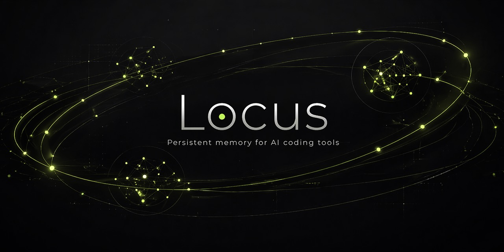

# Locus

> 面向 AI 编程工具的本地持久记忆。基于 MCP 构建，当前优先支持 Codex CLI。



[English](../README.md) · [Русский](README.ru.md) · [简体中文](README.zh-CN.md)

## Locus 是什么

AI 编程代理在新会话中通常会忘记项目背景：架构决策、用户偏好、上次修复的问题、下一步计划。Locus 提供一个本地记忆数据库，并通过 MCP 工具让代理查询这些信息。

Locus 可以保存：

- 项目结构：文件、exports、imports
- 重要决策：架构选择、限制、用户偏好
- Codex 会话上下文：错误、后续步骤、被否决的方案、验证结果
- 诊断信息：导入了什么、保存了什么、当前 capture 模式是什么

Locus 默认本地优先。写入记忆不需要云账号、外部数据库、embedding 服务或 LLM 调用。

## Codex 安装

```bash
npx -y locus-memory@latest install codex --yes
```

重启 Codex，然后检查安装状态：

```bash
npx -y locus-memory@latest doctor codex
```

移除 Codex MCP 配置，但保留本地记忆数据：

```bash
npx -y locus-memory@latest uninstall codex --yes
```

安装器会配置 Locus MCP server，安装 Codex skill，启用实用的 `redacted` capture 默认值，并把运行时命令固定到已安装的包版本。

> **发布说明（`v4.0.0`）：** `v4.0.0` 已在 [GitHub Releases](https://github.com/Magnifico4625/locus/releases/tag/v4.0.0) 发布并附带 `locus-memory-4.0.0.tgz`；npm 仓库的 `locus-memory@4.0.0` 仍待发布，在 npm 更新前可使用 GitHub Release 压缩包或本地源码构建（`npm run build`）。

### Zero-Call 桌面插件（Codex、Antigravity、DeepSeek Harness）

支持在会话启动与对话轮次中自动注入上下文摘要并在后台捕获记录，无需每轮显式调用 MCP 工具：

```bash
# Codex CLI / Desktop：zero-call hooks 与 ~/.locus/bin/ 本地运行时
npx -y locus-memory@latest install codex --with-hooks --yes

# Antigravity Desktop：原生插件包（~/.gemini/config/plugins/locus-memory/）
npx -y locus-memory@latest install antigravity --yes
npx -y locus-memory@latest doctor antigravity
npx -y locus-memory@latest uninstall antigravity --yes

# DeepSeek Harness Desktop (`dsh`)：进程内 Cordis 插件（locus-memory-dsh）
npx -y locus-memory@latest install dsh --yes
npx -y locus-memory@latest doctor dsh
npx -y locus-memory@latest uninstall dsh --yes
```

- **Strict Workspace Gate：** 忽略主目录、临时目录、客户端配置目录以及没有项目标记的普通文件夹（可用空 `.locus.json` 或 `~/.locus/config.json` 显式开启）。
- **每日记忆日志（Daily Memory Journal）：** 自动维护 SQLite `daily_summaries` 与 Markdown `journal/YYYY-MM-DD.md`、`journal/INDEX.md`，并通过 `memory_compact` 配合 `PRAGMA wal_checkpoint(TRUNCATE)` 清理过期原始 `tool_use` 记录。
- 多平台插件路线图：[roadmap/v4-multi-platform-plugins.md](roadmap/v4-multi-platform-plugins.md)。

## v4.0 新功能

`v4.0.0` 将共享的本地 SQLite/MCP 内核扩展为多平台 zero-call 桌面记忆层：同时支持 **Codex CLI / Desktop**、**Antigravity Desktop** 与 **DeepSeek Harness Desktop (`dsh`)**，并带来严格的 Workspace Gate、防自注入回环过滤、每日 Markdown 记忆日志以及有界 `memory_compact`。

同时完整保留 Track C 与 Track D 的 Codex 记忆可靠性能力：项目隔离 recall、日期 buckets、`memory_calendar`、`memory_project_state`、rejected alternatives、validation facts 以及多候选澄清字段 `candidateGroups`。详情见 [releases/v4.0.0.md](releases/v4.0.0.md)。

## 为什么选择 Locus

| 需求 | Locus 的做法 |
| --- | --- |
| Codex 一条命令安装 | `npx -y locus-memory@latest install codex --yes` |
| 本地存储 | SQLite，位于 `$CODEX_HOME/memory/`、`~/.claude/memory/` 或 `~/.locus/memory/` |
| 低 token 成本 | 写入在本地完成；只有 recall 时才消耗上下文 |
| 隐私控制 | `metadata`、`redacted`、`full` 三种 capture 模式 |
| 项目级记忆 | 结构扫描 + 决策 + 会话事件 |
| 可检查性 | `memory_status`、`memory_project_state`、`memory_doctor`、`memory_audit`、`memory_review` |

## Capture 模式

| 模式 | 适合场景 | 行为 |
| --- | --- | --- |
| `metadata` | 最安全的诊断模式 | 内容很少，recall 能力有限 |
| `redacted` | 推荐的 Codex 实用模式 | 保存有限片段和关键词，并做 best-effort secret redaction |
| `full` | 最大 recall | 保存更多本地文本；需要明确理解隐私风险 |

推荐的 Codex 设置：

```bash
LOCUS_CODEX_CAPTURE=redacted
LOCUS_CAPTURE_LEVEL=redacted
```

## 对比

Locus 不试图成为完整 agent runtime 或云端记忆平台。它的定位是：轻量、本地、Codex-first 的 coding-agent memory layer。

| 项目 | 主要优势 | Locus 的差异 |
| --- | --- | --- |
| [agentmemory](https://github.com/rohitg00/agentmemory) | 面向 coding agents 的大型 memory stack | Locus 更小、更简单、Codex-first，并通过一个 npm MCP runtime 安装 |
| [AIDE Memory](https://www.aide-memory.dev/) | Path-scoped 本地记忆 | Locus 更强调 MCP tools、Codex JSONL import、诊断和 recall UX |
| [Mem0](https://github.com/mem0ai/mem0) | 通用 AI agents memory layer，生态大 | Locus 更像开箱即用的 coding-tool MCP memory |
| [Letta](https://github.com/letta-ai/letta) | 完整 stateful-agent 平台 | Locus 不替换现有 agent，只给现有工具增加记忆 |
| [Zep / Graphiti](https://github.com/getzep/graphiti) | Temporal knowledge graph 和生产级 context infrastructure | Locus 默认更轻、更本地，适合个人 coding workflow |

完整对比：[comparison.md](comparison.md)

## 常用 MCP 工具

- `memory_recall` — 回答关于过去工作的总结型问题
- `memory_search` — 搜索项目结构、决策和会话事件
- `memory_remember` — 保存重要决策或偏好
- `memory_review` — 查看保存了什么以及为什么保存
- `memory_import_codex` — 手动导入 Codex rollout JSONL
- `memory_status` / `memory_doctor` — 诊断运行状态
- `memory_audit` — 数据和隐私审计
- `memory_forget` / `memory_purge` — 安全删除记忆

## 客户端状态

| 客户端 | 状态 |
| --- | --- |
| Codex CLI / Desktop | 主要验证路径（MCP + 可选 zero-call hooks 已通过实测验证） |
| Antigravity Desktop | 原生插件包与 zero-call hooks 已通过实测验证 |
| DeepSeek Harness Desktop (`dsh`) | 进程内 Cordis 插件（`locus-memory-dsh`）已通过实测验证 |
| Claude Code | 通过 hooks 和 shared runtime 支持 |
| Codex extension | 使用相同 MCP 模型，仍需针对扩展端进行 parity 验证 |
| Cursor / Windsurf / Cline / Zed | MCP tools 可用；被动会话 adapters 是未来工作 |

## 开发

```bash
git clone https://github.com/Magnifico4625/locus.git
cd locus
npm install
npm run check
npm run build
```

License: MIT.
